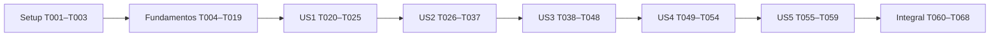

# Tasks: Panel de administración

**Input**: Documentos de `specs/025-panel-administracion/`: spec.md, plan.md, research.md, data-model.md, contracts/administracion.md, contracts/testing-matrix.md y quickstart.md.

**Prerequisites**: Spec y tres aclaraciones iniciales aprobadas, aclaración adicional I1 sobre rechazo histórico, checklist 16/16 y plan revisado. Constitution 1.1.0. Rama `025-Panel-Administracion`.

**Tests**: Obligatorios por solicitud y Constitution. Escribir los tests de cada bloque primero, observar el fallo pertinente y luego implementar hasta dejar el bloque verde; no avanzar con regresiones. `TEST —` identifica tareas de creación/ampliación o ejecución de pruebas automatizadas. No significa que ya estén ejecutadas.

**Organization**: Setup y fundamentos compartidos; después una fase por recorrido US1–US5 de spec.md, en orden de prioridad; cierre transversal. USn.m refiere al escenario m del recorrido n, no a una clave Jira.

**Estado de ejecución final (2026-11-03)**: **68/68 tareas completas y verificadas; 0 pendientes**. Suite definitiva: 1526 passed in 461.37s. Cobertura 35/35 escenarios, 17/17 FR y 7/7 SC. Evidencia automatizada, CI local, revisión visual e inventario en quickstart.md. Los registros de incrementos previos son históricos. Sin commit, push, PR ni merge; Constitution, Spec Kit y otras features intactos.

**Antecedente del primer corte autorizado (superado por el segundo incremento)**: El usuario acotó esta ejecución a modelo/migraciones/autorización, dejando servicios y pantallas para después. Se ejecutaron primero los tests de modelo/migraciones/política de este corte. T006 y la cobertura restante de T007 son requisitos del núcleo y de la integración completa del admin, no se simularon ni se declararon verificadas para avanzar. T008–T011 se completan únicamente en su alcance fundacional; no habilitar panel ni desplegar la feature antes de cerrar el incremento T012–T019. Las adaptaciones mínimas de admin/registro/login mantienen el proyecto compatible con el nuevo constraint, sin sustituir el trabajo pendiente de servicios, revisión firmada, concurrencia y M2M.

## Format: `[ID] [P?] [Story] Description`

- IDs consecutivos T001–T068; `[USn]` obligatorio solo en fases de recorridos.
- `[P]` permite una tarea en paralelo exclusivamente dentro de la ventana indicada, tras sus prerrequisitos. No autoriza editar archivos compartidos simultáneamente.
- Rutas relativas a la raíz actual, concretas; no reutilizar rutas o bases Docker de otra computadora.
- Cada tarea TEST puede contener varios casos parametrizados; la cantidad de tareas no equivale al número de tests ni de escenarios.

## Path Conventions

App existente usuarios; templates administrativos bajo usuarios/templates/usuarios/administracion; tests bajo usuarios/tests. Consultar pruebas y estudios existentes sin crear otra app ni infraestructura genérica. Los nombres de archivos futuros especificados aquí deben verificarse libres antes de crearlos.

## Phase 1: Setup — Preparación y compatibilidad

**Propósito**: Preparar la ejecución posterior sin sobrescribir trabajo local ni crear nuevas dependencias.

- [x] T001 Verificar rama, estado y worktrees, actualizar referencias y comparar cambios de origin/main en `templates/ui/menu.html`, `templates/base.html`, `templates/inicio.html`, `static/src/aqualab.css`, `.github/workflows/ci.yml` y `usuarios/migrations/`; registrar cualquier incompatibilidad en `specs/025-panel-administracion/quickstart.md`, sin merge/rebase ni sobrescrituras automáticas.
- [x] T002 Verificar herramientas y entorno local siguiendo `specs/025-panel-administracion/quickstart.md`, `docker-compose.yml`, `.env.example`, `Dockerfile` y `requirements.txt`; configurar solo entorno local faltante sin sobrescribir .env, usar PostgreSQL 16 y servicios actuales, conservar Python 3.12/Django 5.2/Tailwind 4 y no agregar dependencias.
- [x] T003 Preparar fixtures reutilizables en `usuarios/tests/conftest.py` para administrador_panel distinto del superusuario admin actual, matrices grupo/permiso, Bioquímicos, tres estados, permisos por otras vías y correo; recrear grupos/permisos con get_or_create tras flush transaccional y prever datos históricos con referencias, sin cambiar fixtures de otras apps innecesariamente; depende de T001–T002.

**Checkpoint**: Entorno identificado, ningún trabajo ajeno descartado y fixtures previstas para los bloques de tests. En esta generación HEAD y origin/main coinciden en 8792ec0 después del fetch; repetir T001 al implementar.

## Phase 2: Foundational — Estados, migraciones y servicios compartidos

**Propósito**: Resolver compatibilidad de cuentas y núcleo compartido antes de habilitar pantallas. Las tareas T008–T016 constituyen un incremento coordinado: no desplegar el nuevo esquema aislado de sus adaptaciones de registro/admin/login.

### Tests de fundamentos

- [x] T004 [P] TEST — Escribir invariantes y creación en `usuarios/tests/test_administracion_modelo.py`: tres estados, default de manager/creación directa/superusuario, combinación inválida y revisión; citar y comprobar las reglas «is_active=False OR aprobada=True», «versión >=1» y «Panel solo modifica pertenencia a Bioquímicos» de `specs/025-panel-administracion/data-model.md`; ventana de tests tras T003.
- [x] T005 [P] TEST — Escribir `usuarios/tests/test_administracion_migraciones.py` con MigrationExecutor desde usuarios.0002, modelos históricos, activos/inactivos/superusuarios/grupos/permisos/referencias, constraint, creación idempotente de Administradores/permiso y reversión conservadora; ninguna cuenta inactiva obtiene acceso ni pierde PK/historial; restaurar esquema final en finally (US1.6, US3.9); tras T003.
- [x] T006 [P] TEST — Escribir `usuarios/tests/test_administracion_servicios.py` para núcleo de aprobación/rechazo y adaptadores de canal, atomicidad, callback único por resolución, no-op sin aviso y US2.9: rechazo impedido por PROTECT/firma conserva cuenta/correo/historial/estado/versión y no avisa ni activa; aprobación normal posterior permitida sin perder referencias/firma; conservar otras membresías y comprobar que acceso directo a servicio no elude autorización ni permite desactivación propia (FR-007, FR-008, FR-010, FR-012, FR-016, FR-017); tras T003.
- [x] T007 [P] TEST — Ampliar `usuarios/tests/test_admin.py`, `usuarios/tests/test_notificaciones.py` y `usuarios/tests/test_diagnostico_login.py`: aprobar por ficha/acción un aviso, reactivar ninguno, alta admin sin aviso, desactivación propia impedida por canal correspondiente, ficha obsoleta sin guardado, M2M conservado y diagnóstico pendiente/suspendida solo con contraseña correcta; tras T003, sin editar los archivos de T004–T006.

### Implementación de fundamentos

- [x] T008 Incorporar en `usuarios/models.py` aprobada «Booleano nuevo, default final verdadero», version_administrativa «PositiveBigIntegerField nuevo, default 1, no editable», constraints «is_active=False OR aprobada=True» y «versión >=1», propiedad de estado y etiqueta Activa de is_active; manager deriva aprobación de is_active salvo valor explícito, superusuario fuerza ambos verdaderos y no recibe Administradores; conservar email/PK/contraseña/grupos y declarar permiso usuarios.administrar_panel; después de T004–T007.
- [x] T009 Crear la futura migración `usuarios/migrations/0003_estado_aprobacion.py` desde 0002: agregar aprobación con default temporal falso y revisión 1, backfill solo activos a aprobados con modelos históricos, default final verdadero, etiqueta y constraints; «No alterar is_active ni ninguna identidad/referencia/grupo/permiso/contraseña»; no inferir por last_login/roles/actividad y probar reversión sin conceder accesos; depende de T008 y confirmar numeración libre en T001.
- [x] T010 Crear la futura migración `usuarios/migrations/0004_grupo_administradores.py`: resolver ContentType/permiso histórico antes de post_migrate siguiendo Bioquímicos, get_or_create del grupo y añadir solo administrar_panel sin reemplazar permisos ni inscribir usuarios; reversión conserva grupo con miembros/otros permisos y asignaciones ajenas; depende de T009 y numeración libre (US1.6, FR-002).
- [x] T011 Implementar política central y adaptadores de autorización en `usuarios/permisos_administracion.py`: panel exige autenticado/activo, Administradores y asignación real del permiso por grupos o usuario, sin atajo de superusuario; canal Django Admin conserva staff y permisos change/delete normales; sin backend nuevo ni cambios a estudios.gestionar_catalogo; depende de T010.
- [x] T012 Extraer núcleo transaccional y adaptadores públicos separados en `usuarios/servicios_administracion.py`: recargar actor, autorizar, bloquear actor/objetivos por PK ascendente una sola vez si coinciden, reautorizar bajo atomic, validar estado/revisión, aprobar/rechazar solo pendientes y conservar PROTECT/firma; incluir transiciones de estado usadas por la ficha admin y la invariante compartida de no autodesactivación; incrementar revisión por transición efectiva, copiar datos antes del rechazo y agendar avisos existentes exclusivamente con on_commit, sin SMTP bajo lock ni banderas de bypass desde POST; depende de T011 y cubre T006, los adaptadores de estado del panel se completan en T042.
- [x] T013 Integrar ficha Django Admin en `usuarios/admin.py` y `usuarios/forms.py`, introduciendo los helpers de firma de revisión/instantánea de ficha en `usuarios/confirmaciones_administracion.py` con cobertura T007: bloquear antes de binding en changeform_view, validar original firmado en formulario antes de save_model y preparar aprobada coherente antes de constraints; guardar una sola propuesta fresca mediante núcleo compartido y save_related para M2M en la misma transacción, registrar revisión por grupos/permisos y conservar altas/password/permisos; depende de T012, sin señales ni escrituras dobles; el almacenamiento de borradores de panel se agrega después en T018, no es prerrequisito de la ficha.
- [x] T014 Adaptar acciones masivas y confirmación de rechazo de Django Admin en `usuarios/admin.py` y `usuarios/templates/admin/usuarios/usuario/rechazar_confirmacion.html` para delegar al núcleo, filtrar pendiente completo, mantener log de eliminación, mensajes y permisos originales, ignorar aprobadas/desactivadas y evitar avisos duplicados; depende de T013.
- [x] T015 Adaptar registro/login en `usuarios/views.py`, `usuarios/forms.py` y `usuarios/templates/usuarios/login.html` para crear pendiente explícita y diferenciar pendiente/desactivada en diagnóstico con contraseña correcta; mantener backend, hashing, mensajes genéricos con contraseña errónea, sesión y avisos de nueva solicitud existentes; depende de T014; ajustar solo tests propios que activaban mediante is_active aislado a la transición coherente.
- [x] T016 TEST — Ejecutar y dejar verdes fundamentos y regresiones completas de `usuarios/tests/test_admin.py`, `usuarios/tests/test_notificaciones.py`, `usuarios/tests/test_diagnostico_login.py`, `usuarios/tests/test_registro.py`, `usuarios/tests/test_autenticacion.py`, tests de login/sesión y T004–T006 usando PostgreSQL; comprobar que ficha no sobrescribe la transición ni pierde M2M; registrar evidencia en `specs/025-panel-administracion/quickstart.md`; depende de T015.
- [x] T017 TEST — Escribir `usuarios/tests/test_administracion_confirmaciones.py` para firma/digest/identidad/sesión/objetivo/acción/versionado, token alterado/ajeno/caducado/consumido, cancelación y cotas «TTL 3600 s» y «máximo 20 borradores» de `specs/025-panel-administracion/data-model.md`; sin contraseña/sessionid expuestos y sin usar firma como autorización; depende de T016.
- [x] T018 Extender los helpers existentes desde T013 en `usuarios/confirmaciones_administracion.py` con el flujo de borradores del panel, siguiendo `estudios/confirmaciones_tipos.py` con salts/claves propios, instantánea de identidad/estado/rol/grupos/permisos y propuesta canónica; respetar «TTL 3600 s» y «máximo 20 borradores», descartar/cancelar sin escritura de dominio y comparar revisión bajo bloqueo en servicios; conservar la firma de ficha sin duplicarla y no modificar ni importar almacenamiento específico de tipos; depende de T017.
- [x] T019 TEST — Ejecutar tests de fundamentos/confirmaciones en `usuarios/tests/`, `python manage.py check` y `makemigrations --check --dry-run` contra el diseño de `specs/025-panel-administracion/data-model.md`; dejar registro en `specs/025-panel-administracion/quickstart.md` y no habilitar UI hasta tener compatibilidad verde; depende de T018.

**Checkpoint**: Cuentas actuales/registro/login/admin funcionales, migración conservadora verificada, política/núcleo/confirmaciones disponibles. No aprobar implícitamente históricos; un rechazo impedido por historial no libera email ni manda rechazo.

## Phase 3: User Story 1 — Acceso autorizado (Priority: P1)

**Objetivo**: Política y navegación comunes disponibles para cada pantalla real que se incorpore.

**Independent Test**: Grupo+permiso permite acceso y grupo solo, permiso solo o superusuario sin autorización se rechazan; admin original sigue funcionando. El chequeo de las ocho rutas y los tres enlaces de US1.1 se completa al integrar US2–US4; no crear pantallas ficticias para anticiparlo.

### Tests US1

- [x] T020 [P] [US1] TEST — Crear `usuarios/tests/test_administracion_permisos.py` con matriz de política/servicio, autenticado sin grupo/permiso, superusuario fuera/dentro del grupo sin asignación, administrador_panel sin staff, revocación y caché vieja; US1.2, US1.4, US1.5, FR-003/FR-004; parametrizar el contrato de rutas para habilitar sus casos al integrar cada pantalla, sin sustituir vistas reales por mocks; tras T019.
- [x] T021 [P] [US1] TEST — Crear `usuarios/tests/test_administracion_navegacion.py` para visibilidad, contexto común, diseño y sesión anónima, con verificación de que no se publican enlaces inexistentes; US1.1, US1.3; al completar las rutas exigir los tres accesos finales; tras T019, archivo distinto de T020.

### Implementación US1

- [x] T022 [US1] Incorporar decorador central en `usuarios/permisos_administracion.py` y booleano de navegación en `usuarios/context_processors.py`, compartiendo la política y comprobándola antes de consultar objetivos; mantener login global para anónimos y 403 para autenticados no autorizados; depende de T020–T021.
- [x] T023 [US1] Preparar `usuarios/urls_administracion.py` con namespace administracion y su include `/administracion/` en `config/urls.py`, conservando `/admin/`, login/logout y rutas de otras apps; registrar solo endpoints efectivos a medida que se incorporen, sin rutas públicas sin guardia ni placeholders; depende de T022.
- [x] T024 [US1] Integrar sección Administración incremental en `templates/ui/menu.html` y contexto de `usuarios/context_processors.py` con estilos y aria-current existentes: mostrar únicamente enlaces reales implementados, sin enlaces rotos; mantener todavía tipos en su posición hasta US5 y completar los tres enlaces según T033/T045/T053; depende de T023.
- [x] T025 [US1] TEST — Ejecutar política/contexto y regresiones de sesión/admin desde `usuarios/tests/test_administracion_permisos.py`, `usuarios/tests/test_administracion_navegacion.py`, `usuarios/tests/test_acceso_sesion.py` y `usuarios/tests/test_revalidacion.py`; no declarar cerrado el contrato completo de rutas hasta T061; depende de T024.

**Checkpoint**: Base de seguridad validable por separado, sin enlaces a vistas inexistentes. Primer incremento útil de panel: fundamentos + US1 + US2; US1.1 final requiere además los listados de US3/US4.

## Phase 4: User Story 2 — Solicitudes de cuenta (Priority: P1)

**Objetivo**: Resolver pendientes desde AquaLab conservando avisos y rechazo protegido.

**Independent Test**: Registrar, listar, revisar, cancelar/aprobar/rechazar y repetir; comprobar acceso y avisos, también con dos conexiones PostgreSQL.

### Tests US2

- [x] T026 [P] [US2] TEST — Crear `usuarios/tests/test_administracion_solicitudes.py`: identidad/botones/vacío/paginación, solo pendientes, aprobar/rechazar confirmados y cancelados, cuenta ausente y ya resuelta, email reutilizable y desactivadas excluidas (US2.1–US2.5, US2.8); tras T025.
- [x] T027 [P] [US2] TEST — Crear `usuarios/tests/test_administracion_avisos.py` con mailoutbox/callbacks de commit para resolución única, reenvío sin aviso, rollback sin callback y falla SMTP con log sin revertir; preservar asuntos/cuerpos/destinatarios actuales (US2.2, US2.5–US2.7); tras T025, sin editar el archivo de T026.
- [x] T028 [P] [US2] TEST — Crear `usuarios/tests/test_administracion_concurrencia.py` con transaction=True, conexiones independientes, barreras/eventos y timeout: aprobar/aprobar, aprobar/rechazar, rechazar/rechazar y panel frente a ficha/acción admin; una resolución y callback, sin sobrescritura (US2.6); tras T025, PostgreSQL real, sin mocks de locks ni SQLite.

### Implementación US2

- [x] T029 [US2] Completar adaptadores de aprobación/rechazo del panel en `usuarios/servicios_administracion.py` con validación de revisión/instantánea y objetivo desaparecido, pendiente histórica con referencias/firma y mensajes de conflicto; reutilizar núcleo de T012 sin duplicar lógica/callbacks; depende de T026–T028.
- [x] T030 [US2] Implementar listado y handlers GET/POST de solicitudes en `usuarios/views_administracion.py`: filtro aprobada falso/is_active falso, -date_joined/-pk y 20 por página, revisión/confirmación/cancelación, reautorización y manejo de errores del contrato; depende de T029 y T018.
- [x] T031 [P] [US2] Implementar formularios cerrados de solicitudes en `usuarios/forms_administracion.py`, aceptando solo acción/token/contexto válidos y rechazando cambios a is_staff/is_superuser/grupos/permiso/estado desde campos extra; depende de T030, contrato de contexto fijado.
- [x] T032 [P] [US2] Crear `usuarios/templates/usuarios/administracion/solicitudes.html` y `usuarios/templates/usuarios/administracion/confirmar.html` con identidad/consecuencias, vacío, tabla, paginación y ui/acciones_confirmacion; reutilizar componentes sin editar sus archivos globales; depende de T030, puede acompañar T031 por archivos distintos.
- [x] T033 [US2] Integrar forms/templates/servicios en `usuarios/views_administracion.py`, registrar solicitudes/aprobar/rechazar en `usuarios/urls_administracion.py` y añadir acceso real en `templates/ui/menu.html`; GET sin escritura de dominio, POST confirmar/cancelar y PRG/mensajes según contrato; depende de T031–T032.
- [x] T034 [US2] TEST — Ampliar `usuarios/tests/test_administracion_solicitudes.py` con US2.9, parametrizando pendientes históricas con PROTECT o firma: intentar rechazo por panel y canal admin pertinente, informar motivo, conservar íntegramente cuenta/correo/referencias/firma/historial/estado/versión, cero avisos y acceso denegado; revisar y confirmar aprobación normal posterior, conservando referencias/firma y un único aviso de aprobación, sin activación automática ni aprobación previa supuesta ni relajar PROTECT o borrar referencias/firmas. Verificar además token/cancelación/objetivo eliminado y error de persistencia sin escritura parcial (FR-008, FR-010, FR-016, FR-017); depende de T033.
- [x] T035 [US2] TEST — Ejecutar y ajustar solo la matriz de rutas de solicitudes en `usuarios/tests/test_administracion_permisos.py` para GET/POST con CSRF válido, anónimo, revocación entre revisión/confirmación, actor inactivo y autorización antes de consultar objetivo; US1.2–US1.5 aplicados a US2; depende de T034.
- [x] T036 [US2] TEST — Ejecutar `usuarios/tests/test_administracion_solicitudes.py`, `usuarios/tests/test_administracion_avisos.py`, `usuarios/tests/test_administracion_concurrencia.py`, tests de confirmaciones/permisos y regresiones admin/notificaciones; verificar reenvíos reales y carreras no omitidas; depende de T035.
- [x] T037 [US2] Documentar checkpoint de Solicitudes en `specs/025-panel-administracion/quickstart.md`: aprobación/rechazo y cancelación funcionales, dos acciones desde listado, resultado de correo y límites de on_commit; no publicar ni preparar PR real; depende de T036.

**Checkpoint**: Primer incremento útil: administración de solicitudes completa y admin original compatible, sin afectar catálogo/tipos todavía.

## Phase 5: User Story 3 — Usuarios y roles (Priority: P1)

**Objetivo**: Tres estados, rol independiente y suspensión/reactivación segura.

**Independent Test**: Cambiar rol propio/ajeno conservando permisos, suspender/reactivar otra cuenta sin aviso inicial, impedir suspensión propia y rechazar propuestas obsoletas.

### Tests US3

- [x] T038 [P] [US3] TEST — Crear `usuarios/tests/test_administracion_usuarios.py`: identidad/rol/tres estados, confirmación/cancelación propia y ajena, solo Bioquímicos, coexistencia con Administradores y conservación de otros grupos/permisos individuales aun si conceden facultades equivalentes (US3.1, US3.2, US3.5, US3.10, US3.11); tras T037.
- [x] T039 [P] [US3] TEST — Crear `usuarios/tests/test_administracion_estados.py`: suspensión conserva historia/firma/PK/grupos/permisos, sesión previa pierde acceso, reactivación sin aprobación inicial, pendientes fuera de gestión y prohibición propia por UI/POST/servicio y ficha admin correspondiente (US3.3–US3.6, US3.8; US3.9 ya cubierto por T005); tras T037, archivo distinto de T038.
- [x] T040 [P] [US3] TEST — Ampliar `usuarios/tests/test_administracion_concurrencia.py` con cambios de rol/estado, revisión antigua, A→B→A, identidad cambiada, panel/ficha admin, objetivos cruzados y versión M2M; PostgreSQL real, conexiones independientes y orden de bloqueo verificado (US3.7); tras T037 y T036, sin editar archivos de T038–T039.

### Implementación US3

- [x] T041 [US3] Implementar cambio de rol en `usuarios/servicios_administracion.py` para previamente aprobados: add/remove de Bioquímicos exclusivamente, mismo estado/otros grupos/permisos, rol propio permitido y revisión solo ante cambio efectivo; comprobar autorización y snapshot bajo lock; depende de T038–T040.
- [x] T042 [US3] Implementar suspensión/reactivación en `usuarios/servicios_administracion.py`: solo previamente aprobadas, suspensión propia siempre impedida por el núcleo compartido, conservación de datos y ningún aviso inicial al reactivar; asegurar coherencia de aprobada/is_active/versión y conflictos obsoletos; depende de T041.
- [x] T043 [US3] Ampliar `usuarios/forms_administracion.py` con rol limitado a Usuario común/Bioquímico y confirmaciones de estado: contextos firmados y originales, sin edición libre de otros campos; reutilizar confirmaciones de T018, sin framework genérico nuevo; depende de T042.
- [x] T044 [US3] Incorporar listado y handlers de rol/desactivar/reactivar en `usuarios/views_administracion.py`: usuarios ordenados apellido/nombre/email/PK, 20 por página y rol sin N+1; manejar formulario inválido/conflicto/ausencia/cancelación. Las cuentas pendientes no ofrecen acciones de gestión de rol o estado desde Usuarios y roles. Sobre la cuenta propia únicamente se prohíbe la desactivación; se permite cambiar el propio rol profesional con confirmación. El cambio de rol solo incorpora o retira Bioquímicos, preservando la pertenencia a Administradores, los demás grupos y permisos, conforme a FR-011 y T041; depende de T043.
- [x] T045 [US3] Crear `usuarios/templates/usuarios/administracion/usuarios.html` y `usuarios/templates/usuarios/administracion/rol.html`, reutilizar `usuarios/templates/usuarios/administracion/confirmar.html`, registrar rutas en `usuarios/urls_administracion.py` y acceso real en `templates/ui/menu.html`; Cambiar rol abre una pantalla independiente con rol actual y alternativas, seguida de Continuar y Confirmar; no hay selector inline en el listado; depende de T044, serializar por archivos compartidos con US2.
- [x] T046 [US3] TEST — Ampliar matriz de `usuarios/tests/test_administracion_permisos.py` a listado/rol/desactivar/reactivar, GET/POST 403 con CSRF válido, revocación/caché vieja y campos forjados; ejecutar T038–T040 y comprobar constraints/snapshot/cancelación/rol propio sin pérdida administrativa; depende de T045.
- [x] T047 [US3] TEST — Ejecutar regresiones completas de `usuarios/tests/`, incluyendo `test_admin.py`, `test_diagnostico_login.py`, `test_autenticacion.py` y tests de sesión: activación por ficha no duplica aviso, cambios M2M no se pierden, suspendida no se diagnostica pendiente y error de clave no revela estado; depende de T046.
- [x] T048 [US3] Registrar checkpoint de estados/roles y evidencia de concurrencia en `specs/025-panel-administracion/quickstart.md`, enlazando los escenarios de `specs/025-panel-administracion/contracts/testing-matrix.md`; no alterar estados históricos por inferencias ni añadir restricciones de rol; depende de T047.

**Checkpoint**: Solicitudes y usuarios/roles funcionales con canales administrativos compatibles. US3.9 depende explícitamente de la migración ya validada en fundamentos.

## Phase 6: User Story 4 — Catálogo de consulta (Priority: P2)

**Objetivo**: Buscar y consultar pruebas sin desarrollar otro editor.

**Independent Test**: Consultar datos/estados, buscar código/nombre parcial, paginar/limpiar y abrir ficha existente con sus permisos normales.

### Tests US4

- [x] T049 [P] [US4] TEST — Crear `usuarios/tests/test_administracion_catalogo.py` para catálogo activo/inactivo, cinco datos, búsqueda parcial case-insensitive por código/nombre, espacios/q vacío, paginación conservando q y orden, vacío/limpiar y unidad vacía/-- (US4.1–US4.3, US4.5); tras T048.
- [x] T050 [P] [US4] TEST — Crear `usuarios/tests/test_administracion_catalogo_admin.py` para enlace admin:pruebas_prueba_change, panel sin staff ni permisos de editor, autorización de destino y restricciones existentes de prueba usada; sin concesión de privilegios ni endpoint nuevo de edición (US4.4); tras T048, archivo distinto de T049.

### Implementación US4

- [x] T051 [US4] Implementar consulta de solo lectura en `usuarios/views_administracion.py`: Q(codigo__icontains=q) OR Q(nombre__icontains=q), q.strip(), código/PK y Paginator 20, sin filtro implícito de activa, misma política central; no modificar `pruebas/models.py` ni `pruebas/admin.py`; depende de T049–T050.
- [x] T052 [US4] Crear `usuarios/templates/usuarios/administracion/pruebas.html` con tabla/vacío/buscador/paginación, tipo legible, filtro unidad y enlace admin; reutilizar base y componentes, sin formulario de edición ni permisos nuevos; depende de T051 y contrato de contexto.
- [x] T053 [US4] Registrar GET pruebas en `usuarios/urls_administracion.py` e integrar acceso real en `templates/ui/menu.html`, completando los tres listados de US1.1; catálogo no acepta escritura POST y destino admin mantiene sus checks; depende de T052.
- [x] T054 [US4] TEST — Completar matriz GET/POST de catálogo en `usuarios/tests/test_administracion_permisos.py` y ejecutar T049–T050 junto con `pruebas/tests/test_admin.py` y `pruebas/tests/test_modelo.py`; autorizado POST 405, no autorizado 403, búsqueda no cambia datos y enlace no concede permisos; depende de T053.

**Checkpoint**: Tres listados reales y navegación administrativa completa, sin editor interno. No se crean funcionalidades del catálogo fuera de consulta.

## Phase 7: User Story 5 — Reubicar gestión de tipos (Priority: P2)

**Objetivo**: Trasladar el enlace del menú preservando íntegra la función y autorización independiente.

**Independent Test**: Administrador+gestor ve enlace bajo Administración; administrador sin permiso específico recibe 403 en tipos; gestor sin panel conserva acceso directo y tarjeta Inicio.

### Tests US5

- [x] T055 [P] [US5] TEST — Crear `usuarios/tests/test_administracion_tipos_menu.py` para enlace una sola vez bajo Administración y ausente de Estudios, condiciones de ambos permisos de navegación, ocultación sin permiso específico y tarjeta independiente en Inicio (US5.1, US5.2, US5.4); tras T054.
- [x] T056 [P] [US5] TEST — Crear `usuarios/tests/test_administracion_tipos_acceso.py` para GET/POST de rutas actuales estudios:tipos_*, gestor con solo estudios.gestionar_catalogo sin panel, administrador sin permiso específico 403 y regresiones de operaciones/confirmaciones/tipos usados; no envolver rutas con permiso administrativo (US5.2–US5.4); tras T054, archivo distinto de T055.

### Implementación US5

- [x] T057 [US5] Mover bloque de gestión de tipos en `templates/ui/menu.html` a Administración bajo autorización del panel y permiso específico, manteniendo `templates/inicio.html` y URLs/servicios/vistas de tipos intactos; reutilizar estilos/aria-current y no introducir segundo permiso obligatorio; depende de T055–T056.
- [x] T058 [US5] TEST — Ejecutar T055–T056 y `estudios/tests/test_gestion_tipos_ui.py`, `estudios/tests/test_gestion_tipos_servicio.py`, `estudios/tests/test_gestion_tipos_confirmaciones.py`, `estudios/tests/test_gestion_tipos_concurrencia.py` y tests de diseño; corregir únicamente expectativas de ubicación de menú, no relajar permisos ni operaciones (US5.3); depende de T057.
- [x] T059 [US5] Registrar checkpoint de navegación y acceso directo independiente en `specs/025-panel-administracion/quickstart.md`, con pruebas de gestor sin panel y de panel sin permiso de tipos; confirmar que no se modificó `estudios/gestion_tipos.py` para incorporar permisos nuevos; depende de T058.

**Checkpoint**: Todos los recorridos de Jira integrados. Acceso directo a tipos y Django Admin mantienen sus autorizaciones originales.

## Phase 8: Polish & Cross-Cutting Concerns — Validación integral

**Propósito**: Cerrar cobertura, regresiones, CSS y evidencia de entrega, sin publicación.

- [x] T060 TEST — Auditar trazabilidad escenario→test real para US1.1–US5.4, incluido US2.9, y FR-001–FR-017 en `specs/025-panel-administracion/contracts/testing-matrix.md`; añadir únicamente tests faltantes en `usuarios/tests/test_administracion_*.py`, sin modificar criterios aprobados; exigir 35/35 y nombres concretos de tests, incluidas migración, rechazo impedido y carreras; depende de T059.
- [x] T061 TEST — Ejecutar contrato final de todas las rutas GET/POST reales y menú en `usuarios/tests/test_administracion_permisos.py` y `usuarios/tests/test_administracion_navegacion.py`: CSRF, 403, anónimos, revocación, superusuarios, política antes de objetivo, no escrituras GET, métodos 405 y tres accesos de US1.1; cerrar el checkpoint completo US1; depende de T060.
- [x] T062 TEST — Ejecutar íntegros `usuarios/tests/test_administracion_migraciones.py`, `usuarios/tests/test_administracion_confirmaciones.py`, `usuarios/tests/test_administracion_concurrencia.py` y tests de avisos/admin: PostgreSQL real, callbacks tras commit, rollback, versiones obsoletas y protección histórica; no admitir skips por usar SQLite ni carreras sustituidas por mocks; depende de T061.
- [x] T063 TEST — Ejecutar regresiones completas `usuarios/tests/`, `pruebas/tests/`, `estudios/tests/` e `informes/tests/` y luego pytest completo según `.github/workflows/ci.yml`, incluyendo clientes/muestras, validación y firma/emisión; corregir solo regresiones atribuibles a esta feature y registrar evidencia en `specs/025-panel-administracion/quickstart.md`; depende de T062.
- [x] T064 Recompilar `static/css/aqualab.css` con Tailwind v4.3.3 del Dockerfile desde `static/src/aqualab.css`; si alguna clase solo está en `usuarios/forms_administracion.py`, reutilizar clases ya presentes o ampliar source específicamente, sin escanear specs ni introducir CDN/dependencias; revisar diff de CSS y estilos comunes, no rediseñar otras pantallas; depende de T063.
- [x] T065 TEST — Ejecutar Ruff check/format --check, manage.py check, makemigrations --check --dry-run y verificación reproducible de CSS como `.github/workflows/ci.yml`; no cambiar CI para saltar fallos y no generar migraciones extra sin revisar causa; evidencia en `specs/025-panel-administracion/quickstart.md`; depende de T064.
- [x] T066 Validar recorridos manuales de `specs/025-panel-administracion/quickstart.md` y componentes de `usuarios/templates/usuarios/administracion/`, diseño/labels/foco/aria-current, estados vacíos y SC-005 (máximo tres acciones); documentar evidencia visual y resultados, sin sustituir tests ni modificar especificación; depende de T065.
- [x] T067 Revisar alcance y compatibilidad final comparando main y archivos de la feature, `templates/ui/menu.html`, `templates/inicio.html`, `.github/workflows/ci.yml` y `usuarios/admin.py`; documentar riesgos residuales, límite SMTP y trazabilidad Jira/US real cuando se proporcione en `specs/025-panel-administracion/quickstart.md`, sin inventar identificadores ni integrar main automáticamente; depende de T066.
- [x] T068 Preparar notas revisables para la futura descripción del PR en `specs/025-panel-administracion/quickstart.md`: comportamiento, referencia a spec, migraciones/respaldo, pruebas y pendientes reales; cotejar checkboxes de `specs/025-panel-administracion/tasks.md` solo con evidencia, sin ejecutar commit/push/PR/merge; depende de T067.

**Checkpoint**: Evidencia automatizada/manual y documentación para revisión. El estado ejecutado se registra en los checkboxes y quickstart.md; las descripciones conservan el alcance aprobado.

## Dependencies & Execution Order

### Phase Dependencies

El orden recomendado es serial por archivos compartidos y prioridades. La dependencia funcional mínima de US2/US3/US4 es fundamentos+política US1; la dependencia adicional de ejecución evita conflictos en servicios/forms/views/urls/menú. No presentar las cinco historias como desarrollables simultáneamente sobre esos mismos archivos.

US1.6 y US3.9 se verifican desde fundamentos mediante T005/T010; cada recorrido vuelve a comprobar su integración. US1.1 requiere listados de US2/US3/US4 para completar todos sus enlaces: T024 incorpora navegación incremental y T061 verifica el resultado completo. No anticipar pantallas sin comportamiento, enlaces rotos ni marcadores de funcionalidad innecesarios.

### Dependencias críticas dentro de cada bloque

T003 precede a toda escritura de tests; T004–T007 pueden redactarse juntos. T008→T009→T010→T011→T012→T013→T014→T015→T016 cierra el cambio coordinado de esquema/admin/login; T017→T018→T019 cierra confirmaciones. No desplegar pasos intermedios incompatibles.

En cada recorrido, los tests preceden implementación. T030 fija el contexto y contrato antes de T031/T032; ambas tareas se integran en T033. Servicios compartidos T029/T041/T042 son secuenciales. T045/T053/T057 modifican navegación en orden. T064 precede a T065 para que la validación de CI use CSS vigente.

### Parallel Opportunities

Ventanas habilitadas, sin archivos compartidos: T004/T005/T006/T007 después de T003; T020/T021 después de T019; T026/T027/T028 después de T025; T031/T032 después de T030; T038/T039/T040 después de T037; T049/T050 después de T048; T055/T056 después de T054. Son 18 tareas marcadas [P].

Paralelismo de redacción/edición no implica ejecutar suites sobre una misma base modificada por MigrationExecutor. T005 y cualquier test que cambie esquema se ejecutan aislados, restauran estado y no corren a la vez con suites que usan la misma base. Los tests de concurrencia crean conexiones coordinadas dentro de su propia ejecución, sin compartir una base con otra suite simultánea.

## Parallel Example: User Story 1

Después de T019: redactar T020 en test_administracion_permisos.py y T021 en test_administracion_navegacion.py por separado. No ejecutar aún rutas no implementadas; completar sus casos al registrar cada endpoint y cerrar en T061.

## Parallel Example: User Story 2

Después de T025: redactar T026, T027 y T028 en tres archivos distintos. Después de T030, T031 formularios y T032 templates pueden avanzar con el contrato común; T033 espera ambos. No paralelizar T029 con otro cambio al módulo servicios.

## Parallel Example: User Story 3

Después de T037: T038 roles/listado, T039 estados y T040 carreras se redactan en archivos distintos. Ejecutar pruebas de carreras solo en PostgreSQL aislado. T041/T042 comparten servicios y son secuenciales, al igual que la integración de views/urls/menú con US2.

## Parallel Example: User Story 4

Después de T048: T049 consulta y T050 destino admin se redactan independientemente. T051/T052/T053 se ejecutan en secuencia para fijar contexto e integración; no marcar paralelismo artificial sobre views/menú.

## Parallel Example: User Story 5

Después de T054: T055 menú y T056 acceso directo se redactan en archivos distintos; T057 espera ambos. No modificar la implementación de tipos en paralelo ni extender su autorización.

## Cobertura de escenarios y requisitos

| Escenarios | Tareas TEST principales |
| --- | --- |
| US1.1 | T021, T061 |
| US1.2, US1.4, US1.5 | T020, T035, T046, T054, T061 |
| US1.3 | T021, T025, T061 |
| US1.6 | T005, T019 |
| US2.1, US2.3, US2.4, US2.8 | T026, T035, T036 |
| US2.2, US2.5 | T026, T027, T036 |
| US2.6 | T027, T028, T036, T062 |
| US2.7 | T027, T036 |
| US2.9 | T006, T034, T036, T062 |
| US3.1, US3.2, US3.10, US3.11 | T038, T046 |
| US3.3, US3.4, US3.5, US3.6, US3.8 | T039, T046, T047 |
| US3.7 | T040, T046, T062 |
| US3.9 | T005, T019, T062 |
| US4.1, US4.2, US4.3, US4.5 | T049, T054 |
| US4.4 | T050, T054 |
| US5.1 | T055, T058 |
| US5.2, US5.4 | T055, T056, T058 |
| US5.3 | T056, T058 |

| Requisito | Implementación principal | Validación |
| --- | --- | --- |
| FR-001 | T022–T024, T033, T045, T053 | T021, T061 |
| FR-002 | T008, T010 | T005, T019 |
| FR-003 | T011, T022, T030, T044, T051 | T020, T035, T046, T054, T061 |
| FR-004 | T011, T022, T057 | T020, T055, T056, T061 |
| FR-005 | T018, T031, T032, T043, T045, T052 | T017, T026, T038, T039, T066 |
| FR-006 | T029, T030, T033 | T026, T034, T036 |
| FR-007 | T012–T015, T029 | T006, T007, T027, T028 |
| FR-008 | T012, T014, T029, T032 | T006, T026–T028, T034 |
| FR-009 | T043–T045 | T038, T039, T046 |
| FR-010 | T008, T009, T012–T015, T029, T042 | T004, T005, T006, T007, T034, T039, T047 |
| FR-011 | T041, T043, T045 | T038, T040, T046 |
| FR-012 | T012, T013, T042, T045 | T006, T007, T039, T046 |
| FR-013 | T051–T053 | T049, T054 |
| FR-014 | T052, T053 | T050, T054 |
| FR-015 | T057 | T055, T056, T058 |
| FR-016 | T012–T015, T029, T042 | T006, T007, T027, T028, T039, T062 |
| FR-017 | T008, T012, T013, T018, T029, T041, T042 | T007, T017, T028, T040, T062 |

T060 coteja esta asignación con tests concretos implementados. Cobertura de diseño 35/35 y 17/17 no significa cobertura ejecutada. SC-001–SC-007 se validan mediante la matriz original, pruebas de integración y T066; SC-002 incluye el rechazo impedido y la aprobación normal posterior de US2.9 mediante T006/T034.

## Implementation Strategy

### MVP First

Fundamentos compatibles → US1 política/navegación incremental → US2 solicitudes. Este es el primer incremento con una tarea administrativa completa; US1 aislada sirve para validar seguridad, pero no se presenta como panel funcional terminado. No desplegar migraciones incompatibles antes de adaptar registro/login/admin.

### Incremental Delivery

Después de cada checkpoint, ejecutar tests del recorrido y regresiones afectadas. Añadir Usuarios y roles, después Catálogo y luego traslado de tipos; mantener rutas de funciones existentes y mostrar solo enlaces reales. No desplegar ni publicar durante estas tareas sin autorización posterior.

### Parallel Team Strategy

Usar únicamente ventanas [P] indicadas para archivos distintos tras sus dependencias; un responsable integra los módulos compartidos. No se exige crear agentes, worktrees ni herramientas nuevas para ejecutar este backlog.

## Notes

- Total: **68 tareas**, **32 TEST** (creación/ampliación o ejecución automatizada), **18 [P]**. Prueba manual T066 se cuenta aparte de TEST.
- Distribución: Setup 3; Fundamentos 16; US1 6; US2 12; US3 11; US4 6; US5 5; cierre 9.
- Riesgos conservados del plan: históricos sin aprobación fiable; PROTECT/firma al rechazar; orden de guardado/M2M admin; caché y bypass de permisos; bloqueos cruzados; límites SMTP; escaneo Tailwind de forms_administracion.py. Las tareas asociadas contienen sus mitigaciones.
- Evidencia histórica del primer bloque (superada por registros posteriores): `pytest usuarios/tests -q --tb=short` dio **180 passed in 43.28s** en PostgreSQL 16.15; manage.py check sin incidencias, makemigrations --check --dry-run sin cambios y Ruff check/format en verde. La cobertura HTTP del nuevo panel y las carreras/confirmaciones de servicios no se han implementado. Ver el registro detallado en quickstart.md.
- I1 está formalizado en FR-008, FR-010, SC-002 y US2.9: solo rechazos efectivos de pendientes elegibles eliminan/liberan correo y avisan; el rechazo impedido de una pendiente histórica conserva todo sin aviso ni activación, con revisión y aprobación normal posterior si corresponde. T006/T034 verifican la regla sin nuevas tareas. I2 se corrige en T044 conservando el cambio del propio rol aprobado en FR-011/T041. No modificar Constitution.
- Las notas históricas de requirements.md todavía describen la primera revisión 13/16, aunque sus 16 casillas están aprobadas; no se cambian al generar tareas. La trazabilidad Jira/US real sigue pendiente de proporcionar, sin inventar identificadores.
- No se hallaron diferencias HEAD/origin/main en esta generación; la rama 024 remota no se considera main ni se integra como parte de esta feature.
- No existe `.specify/extensions.yml`; sin hooks before_tasks/after_tasks registrados. Al generar las tareas, el siguiente paso sugerido era `$speckit-analyze`; consultar el cierre posterior para el estado actual.

## Evidencia del segundo incremento

T003/T004/T006/T007 y T012–T019 se marcan tras verificar el núcleo, integración admin, M2M, confirmaciones y concurrencia real. `pytest usuarios/tests -q --tb=short`: **218 passed in 65.90s**; suite completa ejecutada antes de los últimos cinco casos de usuarios: **1367 passed in 415.41s**. La corrida final de usuarios incluye esos casos y los ajustes finales de ficha/contextos. Check de Django sin incidencias, makemigrations --check --dry-run sin cambios, Ruff check verde, 211 archivos con formato correcto y git diff --check verde. Sin hooks after_implement registrados. Detalle e inventario en quickstart.md. T020 conserva cobertura parcial de política; sus endpoints y el resto de recorridos permanecen pendientes.

## Avance del cierre integral (registro intermedio)

T020–T057 verificadas: navegación, solicitudes, roles/estados y catálogo implementados; enlace de tipos reubicado conservando acceso independiente. Evidencia: 76 pruebas iniciales de solicitudes/seguridad; 271 pruebas de usuarios tras roles; 129 de catálogo/tipos/regresiones y 370 de usuarios con matriz HTTP completa. T058–T068 estaban a la espera de regresión general, trazabilidad, CI local y revisión visual; quedaron cerradas en el registro final siguiente. No se modifican requisitos aprobados.

## Cierre final verificado

T020–T068 completas sin agregar ni quitar tareas: **68/68**, **0 pendientes**. `pytest -q --tb=short`: **1526 passed in 461.37s (0:07:41)**, sin skips/fallos, PostgreSQL real. Ruff check verde y format --check con 223 archivos correctos; Django check sin incidencias; makemigrations --check --dry-run sin cambios; Tailwind v4.3.3 reproducible y WeasyPrint PDF correcto; git diff --check verde. Matriz con 35 referencias de escenarios verificadas mediante AST y trazabilidad 17/17 FR, 7/7 SC. Revisión visual real y capturas en evidence/, solo datos sintéticos; servidor local aislado disponible para revisar. T067 registra límites SMTP/históricos y Jira/US real no proporcionado; T068 prepara notas sin publicar. No se ejecuta commit, push, PR ni merge. La comprobación documental final se realiza con speckit-analyze original en solo lectura.

Corrección posterior de UX dentro de T045/T057/T064/T066: botón Revisar cambio, acciones de dos filas estables y alineación del enlace de tipos. Marcado definitivo verificado con **16 passed in 9.38s**, CSS reproducible e inspección real Activa/Desactivada (121 px en ambos estados, sin desbordamiento). Evidencia e inventario del ajuste en quickstart.md. Se mantienen 68/68 tareas; sin cambios funcionales, commit, push o PR.

Ajuste de UX solicitado posteriormente: se sustituye Revisar cambio y el selector inline por el enlace Cambiar rol, pantalla independiente con alternativas al rol actual y confirmación final. Listado compacto sin desbordamiento horizontal en el ancho verificado; 374 tests de usuarios aprobados en 85.00s, Ruff/check Django correctos. Se mantiene el alcance de T043–T045 y T066, sin nuevas tareas ni cambios en grupos/permisos de dominio.
